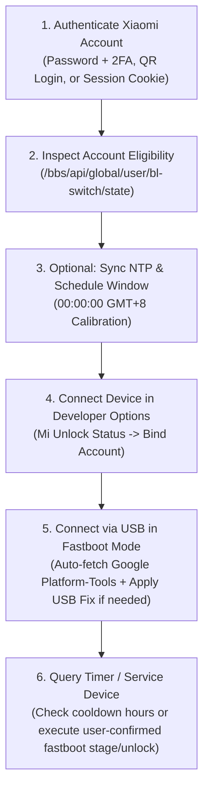

# HyperOS Fastboot Toolkit


**HyperOS Fastboot Toolkit** is an open-source, zero-dependency Python utility (Desktop Tkinter GUI + Terminal CLI) built for inspecting, diagnosing, and servicing Xiaomi, Redmi, and POCO devices running **HyperOS** using standard ADB, Fastboot, NTP synchronization, and Xiaomi's official authentication endpoints.

This repository is distributed strictly as **100% readable Python source code** with no third-party pip dependencies and no prebuilt binaries. On first ADB/Fastboot action, the toolkit automatically downloads Google's official Android SDK Platform-Tools directly from `dl.google.com`.

---

## Features Overview

### 1. Account Session & Eligibility Diagnostics
* **Xiaomi Passport Authentication (`sid=18n_bbs_global` & `sid=unlockApi`):** Supports standard Xiaomi account credentials (with interactive email/SMS 2FA prompt), mobile app QR code authorization (`longPolling/loginUrl`), browser helper, or manual cookie inspection.
* **Automatic Session Refresh:** Persists `unlock_session.json` locally and automatically re-authorizes expired `sid=unlockApi` cookies using isolated session jars without clearing saved tokens.
* **Eligibility Inspector:** Queries `/bbs/api/global/user/bl-switch/state` to report current account status (`is_pass`, `button_state`, and deadline timestamps).

### 2. NTP Time Synchronization & Scheduled Window Utility (`00:00:00 GMT+8`)
* **UDP Port 123 NTP Calibration:** Synchronizes local time offsets against standard public NTP servers (`time.cloudflare.com`, `time.google.com`, `pool.ntp.org`).
* **RTT Latency Measurement:** Measures live round-trip TLS handshake/request latency to `sgp-api.buy.mi.com` (`T-60s` automatic recalibration).
* **Keep-Alive Scheduling (`TCP_NODELAY`):** Pre-warms HTTPS keep-alive sockets before the `00:00:00 GMT+8` window with configurable timing offsets.

### 3. ADB, Fastboot Diagnostics & USB Driver Repair
* **On-Demand Official Google SDK Setup:** Automatically fetches and extracts official Google Android Platform-Tools (`adb` / `fastboot`) from `https://dl.google.com/android/repository/` when needed—no binaries are tracked in Git.
* **Cross-Chipset Fastboot Telemetry:** Reads lock state, product codename, anti-rollback (`anti`) index, and device token across MediaTek (`oem get_token`), Qualcomm (`getvar token`), and legacy Fastboot interfaces.
* **Windows USB 3.0 / MediaTek / AMD Ryzen Fastboot Fix:** Applies targeted `HKLM\SYSTEM\CurrentControlSet\Control\usbflags` descriptor query flags (`SkipBOSDescriptorQuery`, `SkipContainerIdQuery`, `SkipMsOsDescriptorQuery`) for MediaTek (`VID_0E8D`), Xiaomi (`VID_2717`), and Google/Qualcomm (`VID_18D1`) Fastboot USB IDs to eliminate 5-second timeout hangs on Windows 10/11 USB 3.x controllers.
* **Wait-Timer & Official Token Staging:** Communicates with `unlock.update.intl.miui.com` to display remaining cooldown hours or retrieve signed unlock token payloads (`encryptData`) for user-confirmed `fastboot stage` + `fastboot oem unlock`.

### 4. Interactive ADB / Fastboot Console
* Built-in terminal panel routed cleanly through the local Google SDK Platform-Tools directory, with command history navigation and quick diagnostic shortcuts (`adb devices -l`, `fastboot devices`, `fastboot getvar all`, `fastboot reboot`).

---

## Requirements & Quick Start

* **Python 3.8+** (with standard `tkinter` included)
* No external `pip install` packages needed (`requirements.txt` uses Python Standard Library only)

### Launch Desktop GUI
```bash
python hyperunlock_pro.py
```
*(Or double-click [`launch_gui.bat`](launch_gui.bat) on Windows.)*

### Launch Terminal CLI
```bash
python hyperunlock_pro.py --cli
```
*(Or double-click [`launch_cli.bat`](launch_cli.bat) / pass `--auto` to use a saved `token.txt`.)*

---

## Architecture Workflow



### Important Device Notes
1. Always back up important user data before unlocking a bootloader (unlocking performs a factory data reset).
2. Avoid repeating *"Add account and device"* while an active cooldown timer is counting down.
3. On Windows with MediaTek or USB 3.0/Ryzen ports showing `fastboot getvar timed out`, run the built-in **Fix Windows Fastboot USB / Ryzen Bug** helper and replug the USB cable.

---

## Security & Privacy

* **Local-Only Session Storage:** All tokens, cookies, and hardware identifiers stay on your local machine except when communicating directly over TLS with official Xiaomi (`account.xiaomi.com`, `sgp-api.buy.mi.com`, `unlock.update.intl.miui.com`) or Google SDK servers (`dl.google.com`).
* **Strict `.gitignore`:** Credentials and local files (`token.txt`, `xiaomi_session.txt`, `unlock_session.json`, `*.log`, `*.exe`, `*.dll`, `platform-tools/`, `mi-unlock/`) are excluded from Git tracking.

---

## Author

* **Faris Emad Al-Yamni** — Computer Engineering Undergraduate
* **LinkedIn:** [linkedin.com/in/faris-emad-2a852536a](https://www.linkedin.com/in/faris-emad-2a852536a)
* **Email:** [farisemad2019@gmail.com](mailto:farisemad2019@gmail.com)

---

## License

Released under the [MIT License](LICENSE). Copyright (c) 2026 Faris Emad Al-Yamni.
